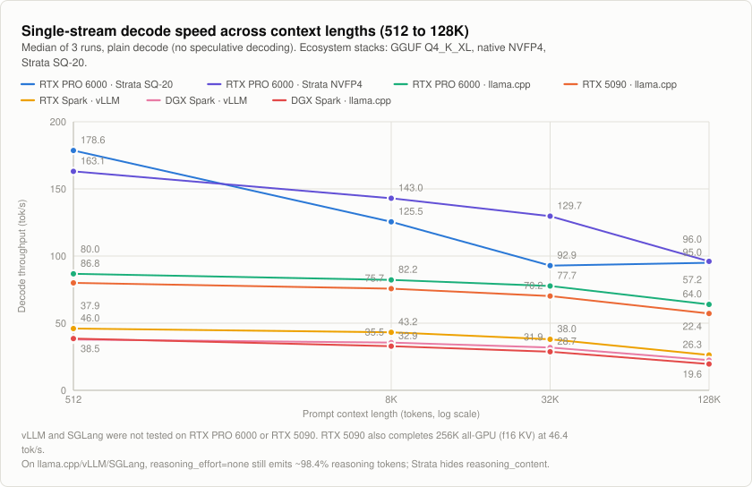
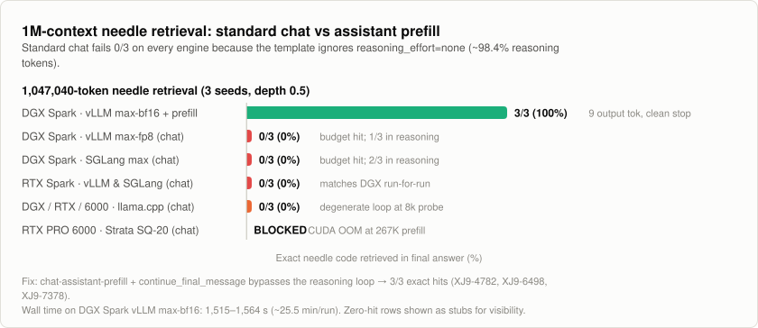
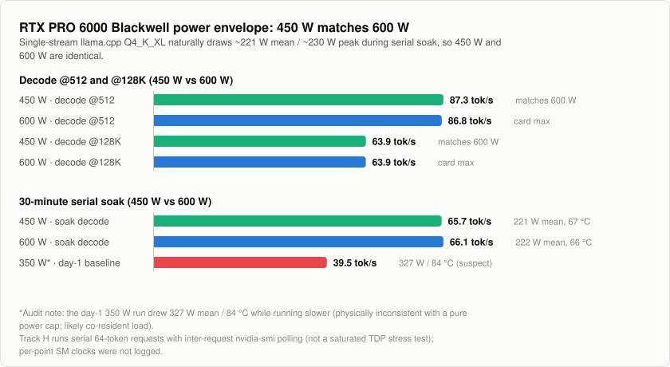
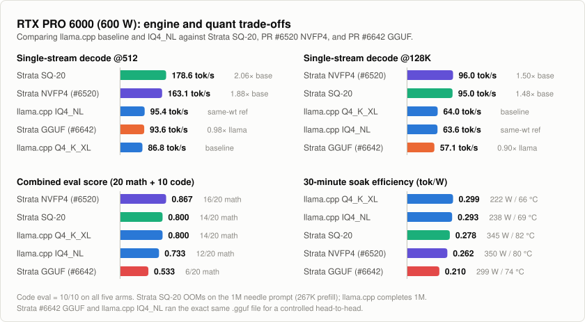

# Inkling-2-Mini — Multi-Hardware & Multi-Engine NVIDIA Benchmark Suite

Independent, reproducible, verify-gated benchmarks of Thinking Machines' **Inkling-2-Mini** (26.2B total / 3.4B active MoE, middle 12 layers looped 3×, 1M context) across **four NVIDIA Blackwell machines** and **four inference engines** (`llama.cpp`, `vLLM`, `SGLang`, `Strata`).

> **v1.0 Release (NVIDIA Blackwell Fleet):** Publishes the 4 completed, PASS-gated NVIDIA systems. **v2.0** will add full Apple Silicon Metal results (**M3 Ultra 256 GB** & **M4 Max 128 GB**), whose 1M-context and BF16 runs are currently completing.

---

## Executive Summary — 5 Headline Findings

1. **The 1M-Context Breakthrough (0/3 → 3/3):** Standard chat scored **0/3 at 1M** on every engine because Inkling-2-Mini's chat template ignores `reasoning_effort=none` (~98.4% reasoning tokens) and loops until hitting the output cap. Bypassing the reasoning loop via **assistant prefill (`continue_final_message`)** unlocked **3/3 (100%) exact 1.047M-token recall in 9 output tokens** on DGX Spark (`vLLM max-bf16`).
2. **The DSpark Speculative Decoding Reversal:** On `llama.cpp`, DSpark slows decode down across every machine (**0.45×–0.58×**, 6–13% acceptance). On native `vLLM` and `SGLang`, DSpark flips into a **3.1×–4.1× speedup** (**183.5 tok/s** on RTX Spark, **142.0 tok/s** on DGX Spark) and **262.9 tok/s** (2.04×, bit-exact) on RTX PRO 6000 Strata native bench.
3. **Engine Trade-Offs on RTX PRO 6000 Blackwell (96 GB):** `Strata v0.2.19 (SQ-20)` doubles `llama.cpp` single-stream (**178.6 vs 86.8 tok/s**) and hits **1,046.6 tok/s @64 streams**, but OOMs at 1M where `llama.cpp` finishes. `Strata #6520 (NVFP4)` achieves the highest eval score (**0.867**) but serializes batch requests (~140 tok/s flat). `Strata #6642 (GGUF)` trails `llama.cpp` on the identical `IQ4_NL` file.
4. **The RTX PRO 6000 Power-Cap Paradox:** Escaping a 350 W power cap to 450 W yields **+167% to +221%** decode speedups while running **18 °C cooler** (66 °C vs 84 °C) and drawing **106 W less mean power** (221 W vs 327 W) during 30-minute soaks. 450 W and 600 W are identical within noise.
5. **RTX Spark 128GB (N1X) Surprises:** Running inside WSL2 on Windows 11 ARM64, the RTX Spark's full **109.67 GiB** CUDA pool runs at full speed (199 GB/s past the 62.4 GiB Windows carve-out), beating DGX Spark on native decode (**+16–23%**) and concurrency (**922.9 vs 842.0 tok/s @64** on `SGLang`).

---

## Hardware Matrix

| System | GPU / Architecture | Memory | OS / CUDA | Engines Verified | Primary Report |
| :--- | :--- | :--- | :--- | :--- | :--- |
| **DGX Spark** (2× nodes) | NVIDIA GB10 (`sm_121`) | 121.7 GiB Unified | DGX OS (Ubuntu 24.04 aarch64), CUDA 13.0 | `llama.cpp`, `vLLM`, `SGLang`, `Strata` pilot | [llama.cpp](reports/dgx-spark-llamacpp.md) · [H2H](reports/dgx-spark-vllm-sglang-h2h.md) |
| **RTX Spark 128GB** | NVIDIA RTX Spark N1X (`sm_121`) | 128 GB LPDDR5x-9400 (109.7 GiB CUDA) | Win11 ARM64 + WSL2 Ubuntu 24.04 | `llama.cpp`, `vLLM`, `SGLang` | [llama.cpp](reports/rtx-spark-llamacpp.md) · [H2H](reports/rtx-spark-vllm-sglang-h2h.md) |
| **RTX PRO 6000 Blackwell** | Workstation Edition (`sm_120`) | 96 GB GDDR7 ECC | Linux x86_64, CUDA 12.8 | `llama.cpp` (350/450/600W), `Strata SQ-20`, `#6642 GGUF`, `#6520 NVFP4` | [Full Report](reports/rtx-pro-6000-blackwell.md) |
| **RTX 5090** | GeForce RTX 5090 (`sm_120`) | 32 GB GDDR7 | Linux x86_64, CUDA 12.8 | `llama.cpp` (all-GPU through 256K) | [Full Report](reports/rtx-5090-llamacpp.md) |

---

## 1. Single-Stream Decode Speed (512 to 128K Context)

<picture>
  <source media="(prefers-color-scheme: dark)" srcset="charts/01-single-stream-decode-dark.svg">
  
</picture>

Median of 3 runs, thinking off, plain decode (no speculation):

| Machine | Engine | Quant | @512 | @8K | @32K | @128K | TTFT @128K |
| :--- | :--- | :--- | ---: | ---: | ---: | ---: | ---: |
| **RTX PRO 6000** | Strata SQ-20 | `SQ-20` | **178.6** | 125.5 | 92.9 | 95.0 | 45.4 s |
| **RTX PRO 6000** | Strata NVFP4 (#6520) | `NVFP4` | 163.1 | **143.0** | **129.7** | **96.0** | **26.5 s** |
| **RTX PRO 6000** | llama.cpp (600W) | `Q4_K_XL` | 86.8 | 82.2 | 77.7 | 64.0 | 77.9 s |
| **RTX 5090** | llama.cpp | `Q4_K_XL` | 80.0 | 75.7 | 70.2 | 57.2 | 94.6 s |
| **RTX Spark** | vLLM | `NVFP4` | 46.0 | 43.2 | 38.0 | 26.3 | 63.3 s |
| **RTX Spark** | SGLang | `NVFP4` | 44.7 | 41.3 | 37.7 | 27.2 | 52.7 s |
| **DGX Spark** | vLLM | `NVFP4` | 37.9 | 35.6 | 31.9 | 22.4 | 58.3 s |
| **DGX Spark** | SGLang | `NVFP4` | 37.9 | 35.5 | 31.6 | 22.2 | 50.7 s |
| **DGX Spark** | llama.cpp | `Q4_K_XL` | 38.5 | 32.9 | 28.7 | 19.6 | 363.6 s |
| **RTX Spark** | llama.cpp | `Q4_K_XL` | 36.3 | 31.7 | 28.3 | 20.4 | 385.1 s |

---

## 2. The DSpark Speculative Decoding Reversal

<picture>
  <source media="(prefers-color-scheme: dark)" srcset="charts/02-dspark-reversal-dark.svg">
  
</picture>

---

## 3. Concurrency Scaling (64 Parallel Streams)

<picture>
  <source media="(prefers-color-scheme: dark)" srcset="charts/03-concurrency-scaling-dark.svg">
  
</picture>

---

## 4. The 1M-Context Breakthrough (1,047,040 Tokens)

<picture>
  <source media="(prefers-color-scheme: dark)" srcset="charts/06-1m-breakthrough-dark.svg">
  
</picture>

---

## 5. RTX PRO 6000 Power Ladder & Engine Trade-Offs

<picture>
  <source media="(prefers-color-scheme: dark)" srcset="charts/04-rtx6000-power-knee-dark.svg">
  
</picture>

<picture>
  <source media="(prefers-color-scheme: dark)" srcset="charts/05-rtx6000-engines-dark.svg">
  
</picture>

---

## Repository Structure & Regenerating Charts

All charts are deterministic, zero-dependency Python stdlib SVGs (dark + light variants) aligned with [`GumbiiDigital/omlx-fleet-bench`](https://github.com/GumbiiDigital/omlx-fleet-bench).

```bash
python3 scripts/export_csvs.py
python3 scripts/build_charts.py
```

- [`dashboard/index.html`](dashboard/index.html) — Self-contained interactive benchmark dashboard with Light/Dark switcher.
- [`data/benchmarks.json`](data/benchmarks.json) + `data/*.csv` — Single source of truth and normalized CSV tables.
- [`charts/`](charts/) — 12 deterministic SVG charts (`-dark.svg` & `-light.svg`).
- [`social/twitter-threads.md`](social/twitter-threads.md) — Ready-to-post X/Twitter threads.
- [`reports/`](reports/) — Archived full verify-PASS reports from every machine.
