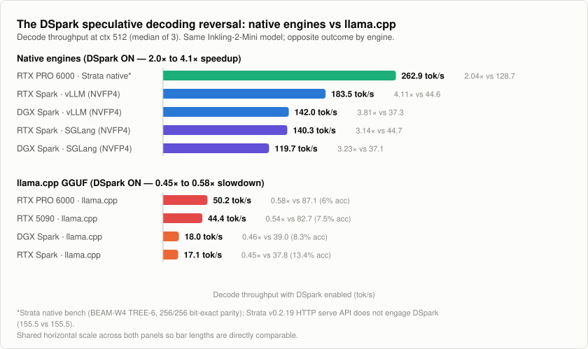
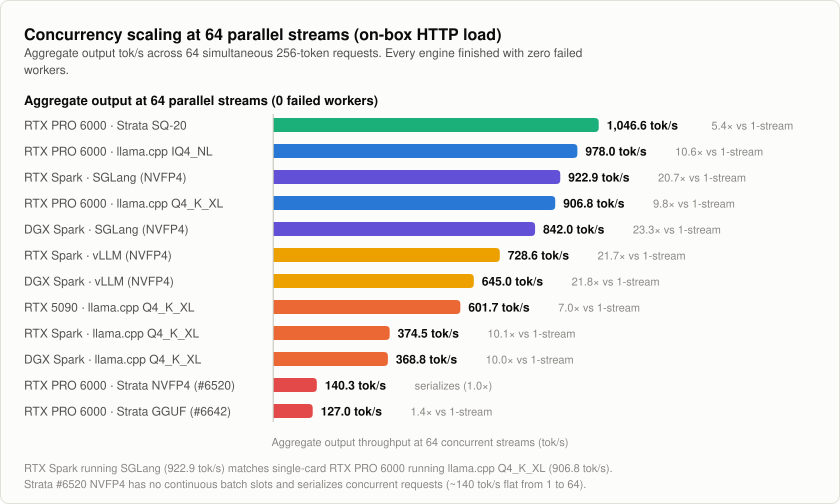
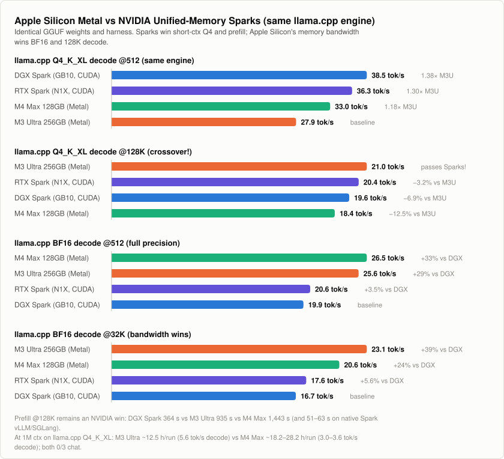

# Inkling-2-Mini — 6-Machine NVIDIA Blackwell & Apple Silicon Benchmark Suite

**[Open the Live Interactive Dashboard →](https://gumbiidigital.github.io/inkling-2-fleet-bench/dashboard/)**

Independent, reproducible, verify-gated benchmarks of Thinking Machines' **Inkling-2-Mini** (26.2B total / 3.4B active MoE, middle 12 layers looped 3×, 1M context) across **six machines** (4 NVIDIA Blackwell + 2 Apple Silicon Metal) and **four inference engines** (`llama.cpp`, `vLLM`, `SGLang`, `Strata`).

> **v2.0 Release (Full 6-Machine Fleet):** Adds full Apple Silicon Metal benchmarks (**Mac Studio M3 Ultra 256 GB** — Verify PASS incl. 1M & BF16 — and **M4 Max 128 GB** — Verify PASS ≤262K + all 3×1M runs completed on-box) alongside the 4 NVIDIA Blackwell systems.

---

## Executive Summary — 5 Audited Findings

1. **1M-Context Diagnostic (0/3 Standard Chat → 3/3 With Assistant Prefill):** Standard chat scored **0/3 at 1M** on every engine because Inkling-2-Mini's chat template ignores `reasoning_effort=none` (~98.4% reasoning tokens) and loops until hitting `finish_reason=length`. Bypassing the reasoning loop with a 4-word **assistant prefill** (`continue_final_message`) on DGX Spark (`vLLM max-bf16`) recovered **3/3 exact needles in 9 output tokens** (~25.5 min/run)—proving the 1M KV attention state retains the fact, even though free-form 1M reasoning remains unusable.
2. **Engine Choice Dominates Hardware on Unified-Memory Sparks:** On DGX Spark and RTX Spark 128GB, native NVFP4 engines (`vLLM`, `SGLang`) cut 128K prefill latency **6–7×** (~51–63 s vs 364–385 s on `llama.cpp`) and lift 64-stream throughput **2.3×–2.5×** (`842–923` vs `369–375 tok/s`, with warm prefix/radix caching active). On identical `llama.cpp Q4_K_XL`, the RTX PRO 6000 workstation card is still **2.42× faster** than RTX Spark (`906.8` vs `374.5 tok/s`).
3. **DSpark Speculative Decoding Splits Sharply by Engine (With an Important Caveat):** On `llama.cpp` (early Unsloth `b12588-mix` GGUF drafter), DSpark is a **0.45×–0.58× slowdown** everywhere (6–14% acceptance). On `Strata` native bench (`BEAM-W4 TREE-6`), DSpark delivers a **real, bit-exact 2.04× speedup** (`262.9` vs `128.7 tok/s`, 256/256 parity), though Strata's v0.2.19 HTTP serve API does not engage it. On `vLLM`/`SGLang`, Track J hit **3.1×–4.1×** (`119.7–183.5 tok/s`), *but* raw-log auditing showed those runs looped on 1-token NATO filler (`"mike mike..."`)—making 3.1×–4.1× a synthetic upper bound, not real-text throughput.
4. **RTX PRO 6000 (96 GB) Engine Trade-Offs:** `Strata SQ-20` doubles `llama.cpp` single-stream (`178.6` vs `86.8 tok/s`) and hits `1,046.6 tok/s @64`, but OOMs at 267K on the 1M prompt where `llama.cpp` completes. `Strata #6520 NVFP4` is fast single-stream (`163.1`) and scored highest on our small eval set (`0.867`), but **serializes batching** (flat `~140 tok/s`). `Strata #6642 GGUF` trails `llama.cpp` on the identical `IQ4_NL` file and suffers early-EOS truncation.
5. **RTX PRO 6000 Power Envelope (450 W = 600 W):** Single-stream `llama.cpp Q4_K_XL` naturally draws only ~221 W mean / ~230 W peak during serial soak, so **450 W and 600 W are indistinguishable within 0.6%** (`87.3` vs `86.8 tok/s`, `66–67 °C`). (Our day-1 350 W run showed `327 W / 84 °C` while running slower—flagged in our audit as likely co-resident GPU load rather than a pure power-cap effect.)

---

## Hardware Matrix

| System | GPU / Architecture | Memory | OS / CUDA | Engines Verified | Primary Report |
| :--- | :--- | :--- | :--- | :--- | :--- |
| **DGX Spark** (2× nodes) | NVIDIA GB10 (`sm_121`) | 121.7 GiB Unified | DGX OS (Ubuntu 24.04 aarch64), CUDA 13.0 | `llama.cpp`, `vLLM`, `SGLang`, `Strata` pilot | [llama.cpp](reports/dgx-spark-llamacpp.md) · [H2H](reports/dgx-spark-vllm-sglang-h2h.md) |
| **RTX Spark 128GB** | NVIDIA RTX Spark N1X (`sm_121`) | 128 GB LPDDR5x-9400 (109.7 GiB CUDA) | Win11 ARM64 + WSL2 Ubuntu 24.04 | `llama.cpp`, `vLLM`, `SGLang` | [llama.cpp](reports/rtx-spark-llamacpp.md) · [H2H](reports/rtx-spark-vllm-sglang-h2h.md) |
| **RTX PRO 6000 Blackwell** | Workstation Edition (`sm_120`) | 96 GB GDDR7 ECC | Linux x86_64, CUDA 12.8 | `llama.cpp` (450/600W + 350W*), `Strata SQ-20`, `#6642 GGUF`, `#6520 NVFP4` | [Full Report](reports/rtx-pro-6000-blackwell.md) |
| **RTX 5090** | GeForce RTX 5090 (`sm_120`) | 32 GB GDDR7 | Linux x86_64, CUDA 12.8 | `llama.cpp` (all-GPU through 256K) | [Full Report](reports/rtx-5090-llamacpp.md) |
| **Mac Studio M3 Ultra** | Apple M3 Ultra (Metal) | 256 GB Unified (~800 GB/s) | macOS 27.2.1 (arm64) | `llama.cpp` Metal (Q4/IQ4/Q8/BF16, 1M PASS) | [Full Report](reports/m3-ultra-256gb-metal.md) |
| **M4 Max** | Apple M4 Max (Metal) | 128 GB Unified (~546 GB/s) | macOS 27.2.1 (arm64) | `llama.cpp` Metal (Q4/IQ4/Q8/BF16, 3×1M archived) | [Full Report](reports/m4-max-128gb-metal.md) |

---

## 1. Single-Stream Decode Speed (512 to 128K Context)

<picture>
  <source media="(prefers-color-scheme: dark)" srcset="charts/01-single-stream-decode-dark.svg">
  
</picture>

Median of 3 runs, plain decode (no speculation):

| Machine | Engine | Quant | @512 | @8K | @32K | @128K | TTFT @128K |
| :--- | :--- | :--- | ---: | ---: | ---: | ---: | ---: |
| **RTX PRO 6000** | Strata SQ-20 | `SQ-20` | **178.6** | 125.5 | 92.9 | 95.0* | 45.4 s |
| **RTX PRO 6000** | Strata NVFP4 (#6520) | `NVFP4` | 163.1 | **143.0** | **129.7** | **96.0** | **26.5 s** |
| **RTX PRO 6000** | llama.cpp (600W) | `Q4_K_XL` | 86.8 | 82.2 | 77.7 | 64.0 | 77.9 s |
| **RTX 5090** | llama.cpp | `Q4_K_XL` | 80.0 | 75.7 | 70.2 | 57.2 | 94.6 s |
| **RTX Spark** | vLLM | `NVFP4` | 46.0 | 43.2 | 38.0 | 26.3 | 63.3 s |
| **RTX Spark** | SGLang | `NVFP4` | 44.7 | 41.3 | 37.7 | 27.2 | 52.7 s |
| **DGX Spark** | vLLM | `NVFP4` | 37.9 | 35.6 | 31.9 | 22.4 | 58.3 s |
| **DGX Spark** | SGLang | `NVFP4` | 37.9 | 35.5 | 31.6 | 22.2 | 50.7 s |
| **DGX Spark** | llama.cpp | `Q4_K_XL` | 38.5 | 32.9 | 28.7 | 19.6 | 363.6 s |
| **RTX Spark** | llama.cpp | `Q4_K_XL` | 36.3 | 31.7 | 28.3 | 20.4 | 385.1 s |

*\*Strata SQ-20 @128K raw runs were `[94.98, 105.02, 41.65]` (median 95.0, one slow outlier).*

---

## 2. DSpark Speculative Decoding

<picture>
  <source media="(prefers-color-scheme: dark)" srcset="charts/02-dspark-reversal-dark.svg">
  
</picture>

---

## 3. Concurrency Scaling (64 Parallel Streams)

<picture>
  <source media="(prefers-color-scheme: dark)" srcset="charts/03-concurrency-scaling-dark.svg">
  
</picture>

---

## 4. 1M-Context Diagnostic (1,047,040 Tokens)

<picture>
  <source media="(prefers-color-scheme: dark)" srcset="charts/06-1m-breakthrough-dark.svg">
  
</picture>

---

## 5. RTX PRO 6000 Power Envelope & Engine Trade-Offs

<picture>
  <source media="(prefers-color-scheme: dark)" srcset="charts/04-rtx6000-power-knee-dark.svg">
  
</picture>

<picture>
  <source media="(prefers-color-scheme: dark)" srcset="charts/05-rtx6000-engines-dark.svg">
  
</picture>

---

## 6. Apple Silicon Metal vs NVIDIA Unified-Memory Sparks (Same `llama.cpp` Engine)

<picture>
  <source media="(prefers-color-scheme: dark)" srcset="charts/07-apple-silicon-vs-nvidia-dark.svg">
  
</picture>

- **Q4_K_XL crossover at long context:** On identical `llama.cpp` weights, the NVIDIA Sparks lead at 512 ctx (`38.5` / `36.3` vs M4 Max `33.0` / M3 Ultra `27.9 tok/s`), but **M3 Ultra (`21.0 tok/s`) overtakes both Sparks (`19.6` / `20.4`) and M4 Max (`18.4`) at 128K** as KV-cache bandwidth dominates.
- **Full-precision BF16 win for Apple Silicon:** Both Macs (**M4 Max `26.5`** / **M3 Ultra `25.6`** @512; **M3 Ultra `23.1`** @32K) beat both NVIDIA Sparks (**`19.9–20.6`** @512; **`16.7–17.6`** @32K) by **+25% to +39%**.
- **Prefill stays an NVIDIA strength:** At 128K `llama.cpp`, DGX Spark prefills in `364 s` vs M3 Ultra `935 s` vs M4 Max `1,443 s` (and `51–63 s` on native Spark `vLLM`/`SGLang`). At 1M context, M3 Ultra completed all 3 runs in ~12.5 h/run (`23.1 tok/s` prefill, `5.6 tok/s` decode, `0/3` chat, `1/3` found in reasoning); M4 Max completed all 3 runs on-box in `18.2 / 18.8 / 28.2 h` (`3.0–3.6 tok/s` decode).
- **Fleet-wide `llama.cpp` DSpark confirmation (6/6 hosts):** Both Macs confirm the exact same `llama.cpp` GGUF drafter slowdown (M3 Ultra `0.58×`, M4 Max `0.57×`).

---

## Can I Trust These Numbers? — Known Limitations & Preemptive Audit Notes

Before sharing this dataset, we ran an adversarial raw-JSON and harness-code audit across all four workspaces. Every number above matches the raw JSON records on disk, **and** here are the exact limitations and caveats you should know before drawing conclusions:

1. **No `vLLM` or `SGLang` on RTX PRO 6000 or RTX 5090:** Comparing RTX Spark `SGLang` (`922.9 tok/s @64`) to RTX PRO 6000 `llama.cpp Q4_K_XL` (`906.8 tok/s @64`) is an **engine comparison, not a hardware comparison**. On identical `llama.cpp Q4_K_XL`, RTX PRO 6000 is **2.42× faster** (`906.8` vs `374.5 tok/s`), and `llama.cpp IQ4_NL` hits `977.7 tok/s`.
2. **Track E concurrency uses an identical short prompt (warm prefix/radix caching):** All 64 workers sent the exact same 512-char prompt across 3 runs without a per-request nonce, and neither `--disable-radix-cache` (SGLang) nor `--no-enable-prefix-caching` (vLLM) was set. On `llama.cpp`, run 0 was consistently 11–23% slower than runs 1–2, so the reported median is a warm-cached run.
3. **Track J (`vLLM`/`SGLang` 3.1×–4.1× DSpark) ran on degenerate NATO-filler loops:** Inspecting the raw completion text showed `vLLM` and `SGLang` looping on 1-word NATO tokens (`"mike mike..."`, `"quebec quebec..."`), driving huge variance (`67.5–208.2 tok/s`) and up to 99% acceptance. Treat 3.1×–4.1× as a **synthetic low-entropy upper bound**. Strata's native bench (`2.04×`, 256/256 bit-exact parity) is the cleaner real-text DSpark reference, while `llama.cpp`'s 0.45×–0.58× slowdown reflects an early Unsloth `b12588-mix` GGUF drafter rather than a fundamental flaw in DSpark.
4. **RTX PRO 6000 day-1 350 W baseline anomaly:** While **450 W vs 600 W** (both run cleanly on 2026-11-22) prove this workload peaks around ~230 W and needs no more than 450 W, the day-1 350 W baseline averaged `327 W / 84 °C` while running *slower* than 450 W (`221 W / 67 °C`) and had a 116% mid-test jump on `A@128K`. That points to a likely co-resident GPU workload or abnormal GPU state on day 1 rather than a pure power-cap effect, and per-point SM clocks were not logged.
5. **Track H soak is a serial 64-token loop, not a saturated TDP stress test:** `soak.py` runs 64-token requests back-to-back and polls `nvidia-smi` synchronously *between* requests; its effective `decode_tok_s` also includes prefill + SSH/Python overhead (explaining why RTX Spark over Tailscale SSH dropped to `21.6 tok/s` while local WSL2 hit `39.8 tok/s`).
6. **1M-context assistant-prefill proof is a narrow KV-retention diagnostic:** Tested on 1 box (`DGX Spark`), 1 engine (`vLLM max-bf16`), 1 depth (`0.5`), synthetic NATO haystack, forced 4-word assistant prefix (`"The hidden code is"`), `n=3`, ~25.5 min/run. It proves the 1M KV state retains the needle when the broken reasoning loop is bypassed—not general-purpose 1M reasoning. (Raw forced-prefix Arm B hallucinated `3X7-5778`.)
7. **Small eval sample sizes & default sampling temperature:** Track C (`20` math + `10` code items) did not pass `temperature=0.0`, so engines used default sampling temperature (explaining ±1–3 item math drift across runs). Track G Vision (`8` synthetic 128×128 squares, all expected `"8"`, substring check) is strictly a **multimodal wiring smoke check**, not a vision capability benchmark.
8. **Different weights, OSes, and blocked cells:** Cross-engine comparisons are "recommended ecosystem stacks" (`Q4_K_XL` vs `NVFP4` vs `SQ-20`); only `Strata #6642` vs `llama.cpp IQ4_NL` ran the exact same `.gguf` file (and `#6642` truncated early at ~52 tok/req in Track E). RTX Spark H2H ran inside WSL2 (missing `nvidia-smi` power/temp, SGLang `mem-fraction-static 0.95` vs DGX Spark `0.75`). RTX 5090 BF16 is blocked by an `sm_120` VMM partial-offload corruption bug; Strata SQ-20 OOMs at 267K on the 1M prompt.
9. **Apple Silicon notes (v2.0):** Both Macs ran `llama.cpp` Metal only (no `vLLM`/`SGLang`/`Strata` on macOS) and have no `sudo powermetrics` wattage telemetry (`pmset -g therm` remained `nominal` with flat 30-min soak throughput). On M4 Max (`m41`), all 3 × 1M runs completed on-box (`18.22 h`, `18.80 h`, `28.17 h`; Run 3 JSON + full 3-run server log archived), while a control-host reboot during Run 3 dropped the in-memory Run 1–2 chat bodies before `needle.py` wrote the final point JSON; rather than re-running ~60 hours, we archived the full server log and Run 3 JSON directly.

---

## Repository Structure & Regenerating Charts

All charts are deterministic, zero-dependency Python stdlib SVGs (dark + light variants) aligned with [`GumbiiDigital/omlx-fleet-bench`](https://github.com/GumbiiDigital/omlx-fleet-bench).

```bash
python3 scripts/export_csvs.py
python3 scripts/build_charts.py
```

- **[Live Interactive Dashboard](https://gumbiidigital.github.io/inkling-2-fleet-bench/dashboard/)** ([source](dashboard/index.html)) — Self-contained interactive benchmark dashboard with Light/Dark switcher & Audit Caveats tab.
- [`data/benchmarks.json`](data/benchmarks.json) + `data/*.csv` — Single source of truth and normalized CSV tables.
- [`charts/`](charts/) — 12 deterministic SVG charts (`-dark.svg` & `-light.svg`).
- [`reports/`](reports/) — Archived full verify-PASS reports from every machine.

---

## Credits and license

Inkling-2-Mini, `llama.cpp`, `vLLM`, `SGLang`, and `Strata` belong to their respective authors. This is an independent engineering record, and no endorsement is implied. Apache License 2.0. See [LICENSE](LICENSE).
