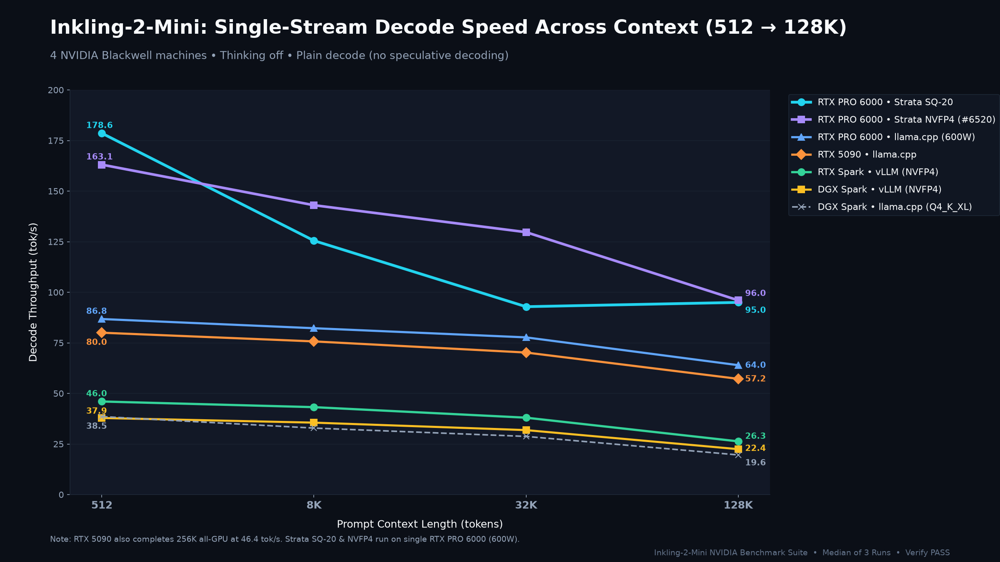
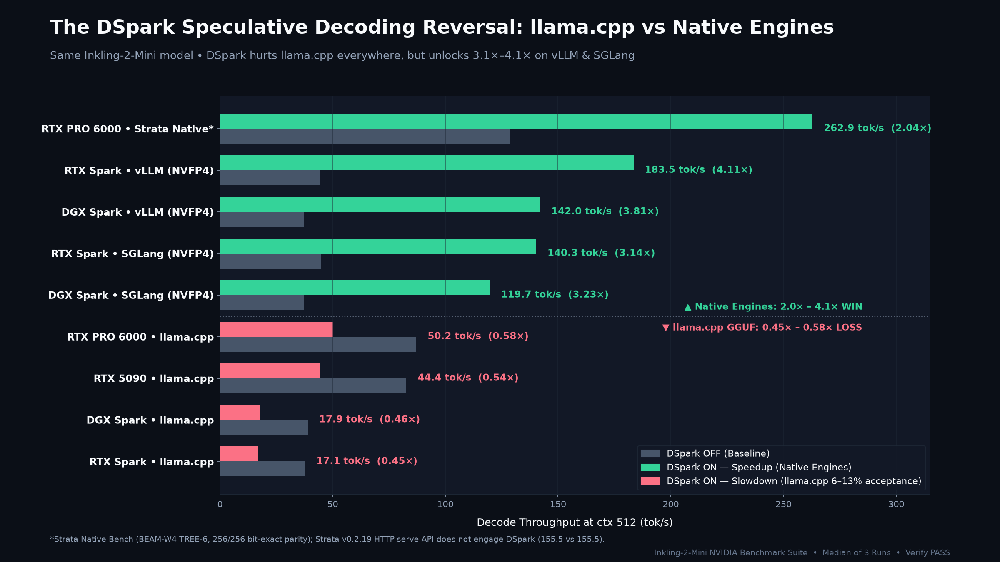
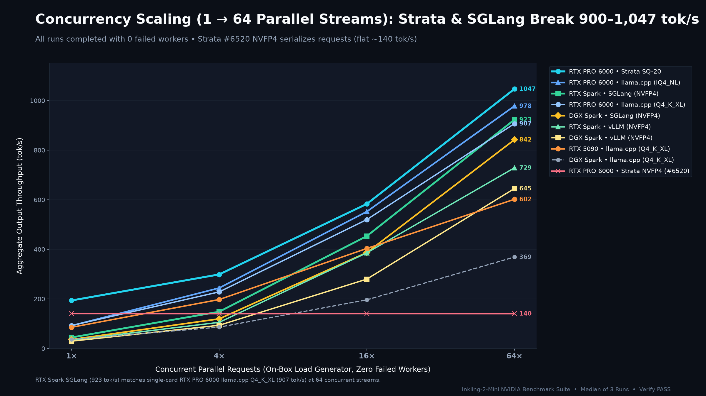
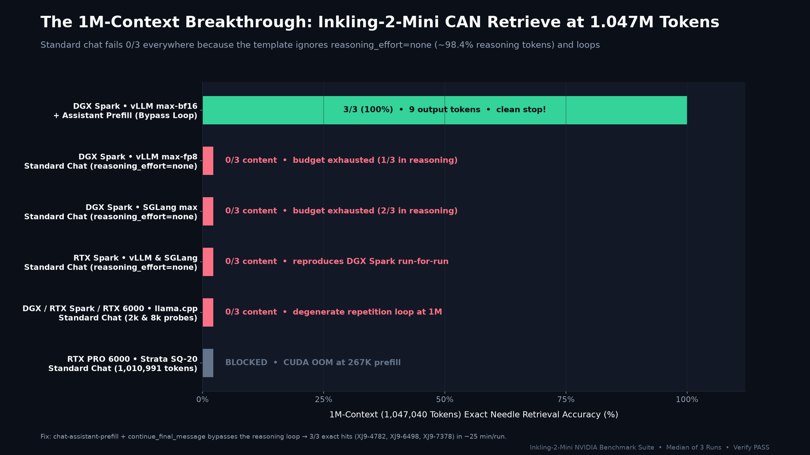
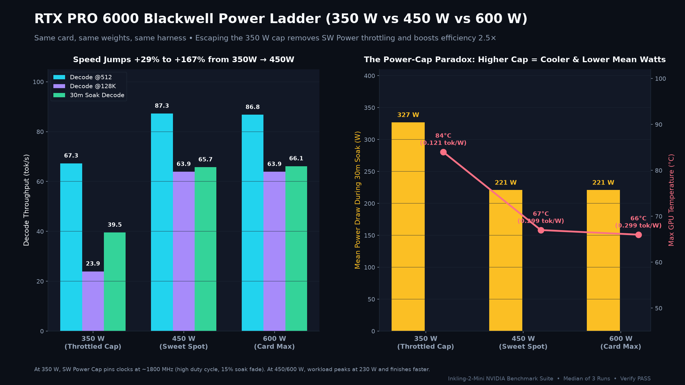
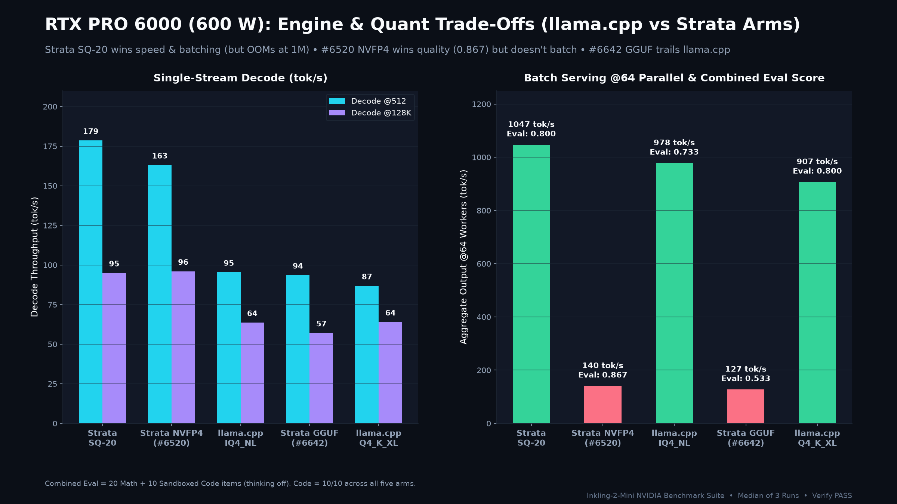

# Inkling-2-Mini — Multi-Hardware & Multi-Engine NVIDIA Benchmark Suite

[-34D399?style=flat-square)](#hardware-matrix)
[-22D3EE?style=flat-square)](#model-under-test)
[](#engine-showdown)

Independent, reproducible, verify-gated benchmarks of Thinking Machines' **Inkling-2-Mini** across **four NVIDIA Blackwell machines** and **four inference engines** (`llama.cpp`, `vLLM`, `SGLang`, `Strata`), covering single-stream decode up to 256K, concurrency scaling to 64 parallel streams, DSpark speculative decoding, 30-minute thermal/power soaks, a controlled RTX PRO 6000 350W/450W/600W power ladder, varloop depth sweeps, and full **1,047,040-token (1M)** needle-in-a-haystack retrieval.

> **v1.0 Release (NVIDIA Blackwell Fleet):** This release publishes the 4 completed, PASS-gated NVIDIA systems. **v2.0** will add full Apple Silicon Metal results (**M3 Ultra 256 GB** & **M4 Max 128 GB**), whose 1M-context and BF16 runs are currently completing.

---

## Executive Summary — 5 Headline Findings

1. **The 1M-Context Breakthrough (0/3 → 3/3):** On standard chat prompts, *every* engine (`llama.cpp`, `vLLM`, `SGLang`) scored **0/3 at 1M** because Inkling-2-Mini's chat template ignores `reasoning_effort=none` (~98.4% reasoning tokens) and burns its output budget looping. Bypassing the reasoning loop via **assistant prefill (`continue_final_message`)** unlocked **3/3 (100%) exact 1.047M-token recall in 9 output tokens** on DGX Spark (`vLLM max-bf16`).
2. **The DSpark Speculative Decoding Reversal:** On `llama.cpp`, DSpark slows decode down across every machine (**0.45×–0.58×**, 6–13% acceptance). On native `vLLM` and `SGLang`, DSpark flips into a **3.1×–4.1× speedup** (**183.5 tok/s** on RTX Spark, **142.0 tok/s** on DGX Spark) and **262.9 tok/s** (2.04×, bit-exact) on RTX PRO 6000 Strata native bench.
3. **Engine Trade-Offs on RTX PRO 6000 Blackwell (96 GB):** `Strata v0.2.19 (SQ-20)` doubles `llama.cpp` single-stream (**178.6 vs 86.8 tok/s**) and hits **1,046.6 tok/s @64 streams**, but OOMs at 1M where `llama.cpp` finishes. `Strata #6520 (NVFP4)` achieves the highest eval score (**0.867**) but serializes batch requests (~140 tok/s flat). `Strata #6642 (GGUF)` trails `llama.cpp` on the identical `IQ4_NL` file.
4. **The RTX PRO 6000 Power-Cap Paradox:** Escaping a 350 W power cap to 450 W yields **+167% to +221%** decode speedups while running **18 °C cooler** (66 °C vs 84 °C) and drawing **106 W less mean power** (221 W vs 327 W) during 30-minute soaks. 450 W and 600 W are identical within noise.
5. **RTX Spark 128GB (N1X) Surprises:** Despite running inside WSL2 on Windows 11 ARM64, the RTX Spark's full **109.67 GiB** CUDA pool runs at full speed (199 GB/s past the 62.4 GiB Windows carve-out), beating DGX Spark on native decode (**+16–23%**) and concurrency (**922.9 vs 842.0 tok/s @64** on `SGLang`).

---

## Hardware Matrix

| System | GPU / Architecture | Memory | OS / CUDA | Engines Verified | Primary Report |
| :--- | :--- | :--- | :--- | :--- | :--- |
| **DGX Spark** (2× nodes) | NVIDIA GB10 (`sm_121`) | 121.7 GiB Unified | DGX OS (Ubuntu 24.04 aarch64), CUDA 13.0 | `llama.cpp`, `vLLM`, `SGLang`, `Strata` pilot | [llama.cpp](reports/dgx-spark-llamacpp.md) · [H2H](reports/dgx-spark-vllm-sglang-h2h.md) |
| **RTX Spark 128GB** | NVIDIA RTX Spark N1X (`sm_121`) | 128 GB LPDDR5x-9400 (109.7 GiB CUDA) | Win11 ARM64 + WSL2 Ubuntu 24.04 | `llama.cpp`, `vLLM`, `SGLang` | [llama.cpp](reports/rtx-spark-llamacpp.md) · [H2H](reports/rtx-spark-vllm-sglang-h2h.md) |
| **RTX PRO 6000 Blackwell** | Workstation Edition (`sm_120`) | 96 GB GDDR7 ECC | Linux x86_64, CUDA 12.8 | `llama.cpp` (350/450/600W), `Strata SQ-20`, `#6642 GGUF`, `#6520 NVFP4` | [Full Report](reports/rtx-pro-6000-blackwell.md) |
| **RTX 5090** | GeForce RTX 5090 (`sm_120`) | 32 GB GDDR7 | Linux x86_64, CUDA 12.8 | `llama.cpp` (all-GPU through 256K) | [Full Report](reports/rtx-5090-llamacpp.md) |

---

## 1. Single-Stream Decode Speed (512 → 128K Context)



Median of 3 runs, thinking off, plain decode (no speculation):

| Machine | Engine | Quant | @512 | @8K | @32K | @128K | TTFT @128K |
| :--- | :--- | :--- | ---: | ---: | ---: | ---: | ---: |
| **RTX PRO 6000** | Strata SQ-20 | `SQ-20` | **178.6** | 125.5 | 92.9 | 95.0 | 45.4 s |
| **RTX PRO 6000** | Strata NVFP4 (#6520) | `NVFP4` | 163.1 | **143.0** | **129.7** | **96.0** | **26.5 s** |
| **RTX PRO 6000** | llama.cpp (600W) | `Q4_K_XL` | 86.8 | 82.2 | 77.7 | 64.0 | 77.9 s |
| **RTX 5090** | llama.cpp | `Q4_K_XL` | 80.0 | 75.7 | 70.2 | 57.2 | 94.6 s |
| **RTX Spark** | vLLM | `NVFP4` | 46.0 | 43.2 | 38.0 | 26.3 | 63.3 s |
| **RTX Spark** | SGLang | `NVFP4` | 44.7 | 41.3 | 37.7 | 27.2 | 52.7 s |
| **DGX Spark** | vLLM | `NVFP4` | 37.9 | 35.6 | 31.9 | 22.4 | 58.3 s |
| **DGX Spark** | SGLang | `NVFP4` | 37.9 | 35.5 | 31.6 | 22.2 | 50.7 s |
| **DGX Spark** | llama.cpp | `Q4_K_XL` | 38.5 | 32.9 | 28.7 | 19.6 | 363.6 s |
| **RTX Spark** | llama.cpp | `Q4_K_XL` | 36.3 | 31.7 | 28.3 | 20.4 | 385.1 s |

> RTX 5090 also completes an all-GPU `f16` KV extension rung at **256K** context: **46.4 tok/s** decode, **1,164 tok/s** prefill, 28.4 GB VRAM.

---

## 2. The DSpark Speculative Decoding Reversal



| Machine | Engine | Ctx | Plain (OFF) | DSpark (ON) | Speedup | Acceptance |
| :--- | :--- | ---: | ---: | ---: | ---: | :--- |
| **RTX PRO 6000** | Strata Native (`BEAM-W4 TREE-6`) | 512 | 128.7 | **262.9** | **2.04×** | 256/256 bit-exact |
| **RTX Spark** | vLLM (NVFP4) | 512 | 44.6 | **183.5** | **4.11×** | 54% (smoke) |
| **DGX Spark** | vLLM (NVFP4) | 512 | 37.3 | **142.0** | **3.81×** | 54.2% |
| **RTX Spark** | SGLang (NVFP4) | 512 | 44.7 | **140.3** | **3.14×** | 34.4% |
| **DGX Spark** | SGLang (NVFP4) | 512 | 37.1 | **119.7** | **3.23×** | — |
| **RTX PRO 6000** | llama.cpp (600W) | 512 | 87.1 | 50.2 | **0.58×** | 6.0% |
| **RTX 5090** | llama.cpp | 512 | 82.7 | 44.4 | **0.54×** | 7.5% |
| **DGX Spark** | llama.cpp | 512 | 39.0 | 18.0 | **0.46×** | 8.3% |
| **RTX Spark** | llama.cpp | 512 | 37.8 | 17.1 | **0.45×** | 13.4% |

---

## 3. Concurrency Scaling (1 → 64 Parallel Requests)



All concurrency runs used an on-box local HTTP load generator with **0 failed workers** at every level.

- **Strata SQ-20 on RTX PRO 6000** tops the fleet at **1,046.6 tok/s** aggregate @64 streams.
- **SGLang on RTX Spark (922.9 tok/s)** and **DGX Spark (842.0 tok/s)** deliver **2.3×–2.5×** the throughput of `llama.cpp` on the same unified-memory hardware.
- **Strata #6520 NVFP4** lacks continuous batch slots and serializes requests (flat **~140 tok/s** from 1→64).

---

## 4. The 1M-Context Breakthrough (1,047,040 Tokens)



Standard chat prompts failed **0/3 at 1M** across every engine (`llama.cpp`, `vLLM`, `SGLang`) because `reasoning_effort=none` is a no-op in Inkling-2-Mini's chat template (~98.4% reasoning tokens). At 1M context, the model frequently spotted the needle inside its reasoning trace but looped until hitting `finish_reason=length`.

On DGX Spark (`vLLM max-bf16`, `ctx_target=1,047,040`), bypassing the reasoning loop via **assistant prefill (`continue_final_message`)** achieved:
- **3/3 (100%) exact hits** (`XJ9-4782`, `XJ9-6498`, `XJ9-7378`)
- **9 output tokens per run**, `finish_reason="stop"`, `reasoning_chars=0`
- Wall time: ~1,515–1,564 s (~25.5 min/run)

---

## 5. RTX PRO 6000 Power Ladder & Engine Showdown





---

## Repository Structure & Interactive Dashboard

- [`dashboard/index.html`](dashboard/index.html) — Self-contained interactive benchmark dashboard (open directly in any browser or serve via GitHub Pages).
- [`data/benchmarks.json`](data/benchmarks.json) — Single source of truth for all normalized NVIDIA benchmark data.
- [`data/*.csv`](data/) — Clean CSV exports (`speed_ladder.csv`, `precision_ladder.csv`, `concurrency.csv`, `speculative_decoding.csv`, `needle_in_haystack.csv`, `evals_and_vision.csv`, `soak_and_power.csv`, `power_ladder_rtx6000.csv`, `varloop.csv`).
- [`charts/*.png`](charts/) — Six 1600×900 dark-mode charts ready for GitHub & X/Twitter.
- [`social/twitter-threads.md`](social/twitter-threads.md) — Ready-to-post X/Twitter threads paired with the exact charts.
- [`reports/`](reports/) — Archived full verify-PASS primary reports from every machine.

### Regenerate CSVs & Charts

```bash
python3 scripts/export_csvs.py
uv run --with matplotlib --with numpy python3 scripts/generate_charts.py
```

---

## Methodology & Honesty Notes

- **Median of 3 runs** per data point; engine-authoritative `predicted_n / predicted_ms` for decode tok/s.
- **Architecture split in `llama.cpp`:** Unsloth GGUFs (`inkling2` arch) require Unsloth `b12588-mix`; `ggml-org` GGUFs (`inkling2_loop` arch: `IQ4_NL`, `BF16`) require mainline `llama.cpp` (`418fe97` / `b12608`).
- **Known hardware/runtime bugs documented, never hidden:**
  - `RTX 5090` `BF16` partial-offload (`-ngl 14`) corrupts output after any ≥10K prefill on `sm_120` (VMM compute-pool bug); recorded as `BLOCKED`.
  - `Strata SQ-20` OOMs at 267K prefill on the 1M needle prompt on single-card RTX PRO 6000; recorded as `BLOCKED`.
  - `WSL2` `nvidia-smi` reports `0.0` for GPU power/temp on RTX Spark native H2H; omitted rather than estimated.
